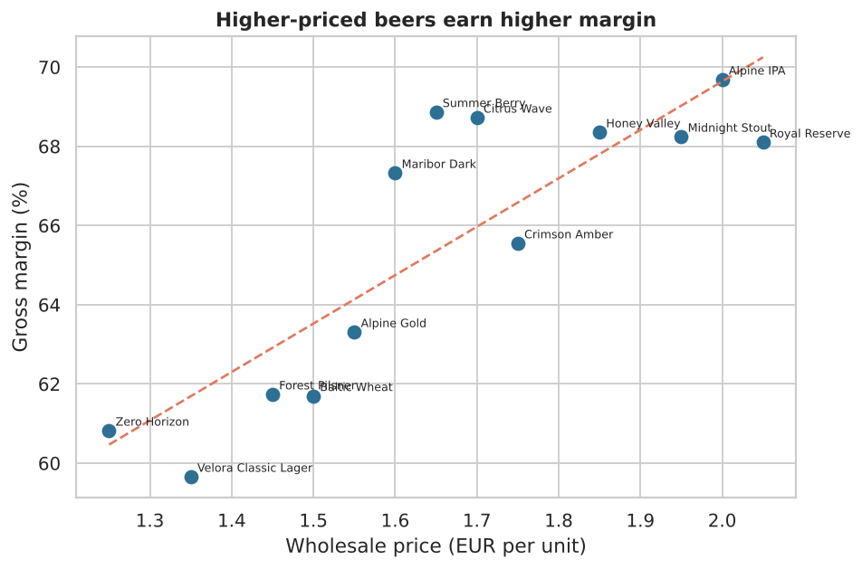
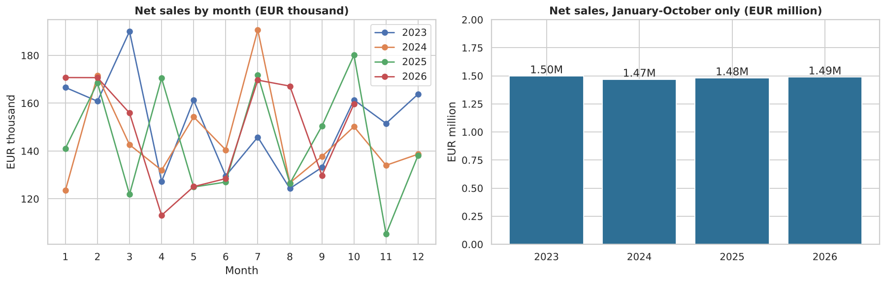

# Velora Brewing - End-to-End Data Science Project

Synthetic brewery dataset (fictional Slovenian brewery, 13 beers, 2023-2026, EUR).
Goal: Excel -> Python -> SQL -> EDA -> Cleaning -> Statistics -> ML -> NLP/GenAI -> Streamlit.

> The data is synthetic and for education only. It is not real brewery data.

## Project structure

    data/raw/         original Excel file (never edit this)
    data/processed/   cleaned data (created later)
    notebooks/        Jupyter notebooks
    src/              reusable Python code
    sql/              SQL queries
    app/              Streamlit dashboard
    reports/          validation report, EDA report

## How to run

    pip install -r requirements.txt
    python src/load_data.py                   # load all sheets
    python src/validate_data.py               # run 6 quality checks -> reports/validation_report.txt
    python src/build_database.py              # build SQLite database -> data/velora.db
    python src/run_queries.py                 # run 20 SQL queries -> reports/sql_results/
    python src/generate_docs.py               # create docs/ (dictionary, KPIs, data model)
    python src/generate_synthetic_data.py     # create synthetic CSVs in data/synthetic/

## Progress

- [x] Step 1: Project setup
- [x] Step 2: Load and validate data
- [x] Step 3: SQL database
- [x] Step 4: Documentation and synthetic data generator
- [x] Step 5: EDA and visualization

## Known data issues (found in Step 2 validation)

1. **Supplier on-time rate conflict.** The Suppliers sheet states about 90%,
   but calculating from Procurement_Orders (actual vs expected delivery)
   gives about 43%. I use the calculated value, following the KPI_Glossary formula.
2. **Customer first_order_date is unreliable.** About 52% of orders happen
   before the customer's stated first_order_date. I derive it from Sales_Orders instead.

## SQL Analysis (Step 3)

The Excel data is loaded into a SQLite database (`data/velora.db`).
20 business queries are in [sql/queries.sql](sql/queries.sql); results are saved
as CSV files in `reports/sql_results/`.
Techniques used: JOIN, GROUP BY, CASE WHEN, CTEs and window functions (LAG, RANK, moving average).
Cancelled orders are excluded from all revenue figures.

### Key findings

- **Revenue and margin:** net sales of about EUR 6.77 million with a 66.0% gross margin.
- **Top products:** Royal Reserve, Midnight Stout and Alpine IPA lead on revenue.
- **Discounts hurt margin:** margin falls from 68.3% (0-5% discount) to 63.0% (15%+ discount).
- **Suppliers:** calculated on-time delivery rates (33%-57%) are far below the rates
  stated in the Suppliers sheet (84%-97%).

### Example result

<!--  -->

### Data limitations

- Inventory movements have no opening stock, so absolute stock levels cannot be calculated.
- Monthly expenses exceed gross profit in every month of this synthetic dataset.
- 2026 contains data only up to October, so year-on-year comparison needs care.

## Documentation (Step 4)

- [Data dictionary](docs/data_dictionary.md): all 17 tables and 134 columns
- [KPI definitions](docs/kpi_definitions.md): formulas, SQL and current values
- [Data model, assumptions and known issues](docs/data_model.md)
- Reproducible generator: `python src/generate_synthetic_data.py --seed 42`

## Exploratory Data Analysis (Step 5)

Full report: [reports/eda_report.md](reports/eda_report.md) | Notebook: [notebooks/02_eda.ipynb](notebooks/02_eda.ipynb) | 19 charts in [reports/figures/](reports/figures/)

**How to run:** open `notebooks/02_eda.ipynb` in Jupyter or VS Code and choose **Run All**. The charts are saved to `reports/figures/`.

Revenue and profit figures exclude cancelled orders. 2026 contains data only up to 31 October, so years are compared January to October.

### Key findings

- **Manufacturing:** average yield is 88.6% and 11.3% of planned volume is lost. Production lines and batch status make no difference to yield.
- **Quality:** 29.7% of batches go to Review. Differences between products and lines are consistent with chance (chi-square p = 0.49 and 0.36), and lab measurements do not explain the decision.
- **Sales:** January to October sales are flat across all four years (EUR 1.47M to 1.50M), with no stable seasonality. Gross margin is 66.0%.
- **Margin follows price:** the cheapest beers earn about 60% margin, the most expensive about 69% (r = 0.85).
- **Discounts do not pay off:** margin falls from 68.3% to 63.0% as discounts rise, while units per order stay the same.
- **Online channel:** 26% of orders but only 2.2% of sales, because online orders are very small.
- **Supply:** 57% of supplier deliveries are late, and the on-time rate stated in the Suppliers sheet cannot be trusted (stated about 90%, calculated about 43%).

### Known data issues

13 issues are documented in [docs/data_model.md](docs/data_model.md). Besides the two listed above, the main new ones are: 3. Procurement purchases (EUR 28.2M) are about four times net sales (EUR 6.8M). 4. Demand_History does not reconcile with the order lines (54% to 63% of the units, rising while orders are flat). 5. `customer_type` and `sales_channel` are unrelated.
