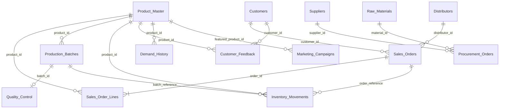

# Data Model, Assumptions and Known Issues

## 1. How the tables connect

Standalone tables with no links: `Employees`, `Monthly_Expenses`, `Equipment_Maintenance`.
All links were checked in Step 2 (no orphan IDs).

**Business flow:** raw materials are bought from suppliers (`Procurement_Orders`), brewed into
beer (`Production_Batches`), tested (`Quality_Control`), moved through stock (`Inventory_Movements`),
sold to customers (`Sales_Orders` + `Sales_Order_Lines`), and customers react (`Customer_Feedback`).

## 2. Dataset assumptions (original file)

- Fictional Slovenian brewery with 13 beers. All data is synthetic education data, not real records.
- Data period is 2023-01-01 to 2026-10-31 for transactions. `Demand_History` runs to 2026-12 (forecast-period months).
- Currency is EUR. The INR 700 crore valuation is a teaching scenario, not a market value.
- Cancelled orders keep their order lines. **Revenue KPIs exclude cancelled orders.**
- `unit_selling_price_eur` is rounded to 2 decimals, so recomputed net sales differ from the stored value by up to 0.5%. We allow a 1% tolerance.
- Production batches occur exactly every 3 days; each has exactly one QC test on the same day.
- `batch_status` and `order_status` appear to be assigned independently of yield and dates in the file.
- `quality_status` is **not** random: a batch is Review when its pH is outside 4.1-5.0 **or** its measured ABV is more than
  0.30 points from the product's declared ABV. This rule matches 99.4% of batches (the 3 misses sit exactly on the 0.30 boundary).
  It was found in Step 7 with the engineered feature `abv_gap`; confirm the thresholds with the brewery.
- This is an analytical simulation only. It is not regulatory, excise or food-safety evidence.

## 3. Known data issues (found in validation)

| # | Issue | Evidence | How we handle it |
|---|---|---|---|
| 1 | Supplier on-time rate conflicts | Suppliers sheet says about 90%; Procurement_Orders gives about 43% | Use the calculated value (KPI_Glossary formula) |
| 2 | `first_order_date` unreliable | About 52% of orders happen before the customer's first_order_date | Derive it from Sales_Orders |
| 3 | Supplier names do not match categories | e.g. "Alpine Hops GmbH" is listed as "Process supplies", "Maribor Labels" as "Malt" | Do not use `main_category` for analysis; use the Raw_Materials category of what was bought |
| 4 | `issue_category` is unreliable | Each feedback sentence has one sentiment, but the category is random relative to the text | For NLP, trust `sentiment_label`; check `issue_category` before using it as a target |
| 5 | `feedback_text` has only 12 distinct sentences | 500 rows, 12 texts | NLP models will score unrealistically high; say so in the report |
| 6 | Inventory has no opening stock | Movement totals are negative for products | Report net movements, never stock on hand |
| 7 | Expenses exceed gross profit every month | Synthetic cost levels | Describe as a dataset property, not a business conclusion |
| 8 | `season` in Demand_History is inconsistent | e.g. January labelled Spring; labels differ between products in the same month | Rebuild season from the month in Step 6 |
| 9 | 2026 is incomplete | Transactions stop at 2026-10-31 | Compare Jan-Oct across years. Like for like, sales are flat (EUR 1.47M to 1.50M); the full-year drop is only the missing Nov-Dec |
| 10 | Procurement spend far above revenue | Purchases EUR 28.2M vs net sales EUR 6.8M (about 4x) | Compare suppliers and categories only; never compare purchases with revenue |
| 11 | Demand_History does not reconcile with orders | Reports 54%-63% of order-line units and rises while orders are flat | Treat it as a separate series when forecasting |
| 12 | `customer_type` and `sales_channel` unrelated | An "Online Customer" buys only 2% through the Online channel, like every other type | Do not use customer_type to explain channel behaviour |
| 13 | Online orders are tiny | Online has 26% of orders but 2.2% of sales (average 40 units per line, maximum 80) | Analyse Online separately from other channels |
| 14 | QC status is a specification, not a random label | Review = pH outside 4.1-5.0 or ABV more than 0.30 points from the declared ABV (99.4% match); raw averages of Pass and Review look alike because errors go in both directions | Classifying Review from measurements only rediscovers the rule; an honest early-warning model must use pre-test features only |

## 4. Synthetic data generator (`src/generate_synthetic_data.py`)

Creates new data with the same columns as the original. Same `--seed` gives identical files.
Use `--scale 0.5` for half the rows.

| Area | Main assumption |
|---|---|
| Suppliers | 20 suppliers; name, country and category consistent; lead time 2-18 days; stated on-time rate 82%-97% |
| Procurement | 1,200 orders; supplier delivers only its own material category; late with probability (1 - stated on-time rate); lateness 1-11 days |
| Production | Batch every few days; planned 700-3,187 L; yield ~ Normal(product target, 0.045) clipped 75%-99%; status 61.5% Completed / 19.6% Delayed / 18.9% On Hold |
| Quality control | One test per batch; Review when pH is outside 4.1-5.0 or ABV is more than 0.30 points from the declared ABV (the rule found in the original) |
| Sales | 4,500 orders, 1-4 lines each; only products already launched; price = wholesale x 0.94-1.08; discount 0%-18%; cancelled 17% |
| Customers | `first_order_date` derived from orders, so no order precedes it |
| Feedback | 12 sentences; each fixes sentiment AND issue category (so categories are learnable) |

**Deliberate differences from the original** (fixes for issues 1, 2, 3 and 4 above): supplier on-time rate is consistent
with deliveries, first_order_date is consistent with orders, supplier categories match names, and issue_category matches the text.

The generator checks itself (unique IDs, valid links, correct formulas, identical column names) and prints a
KPI comparison against the original file.
