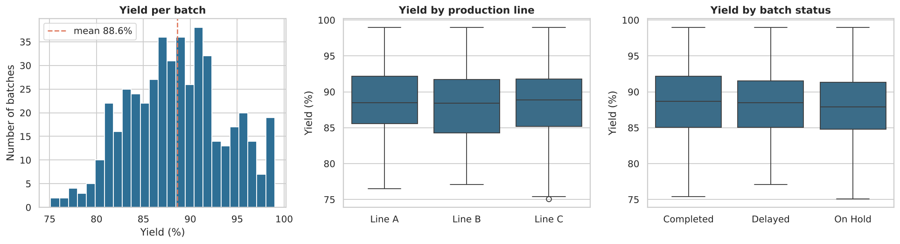
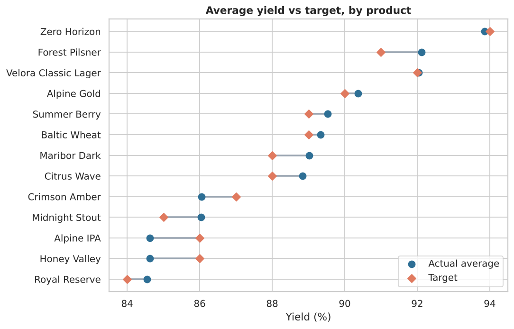
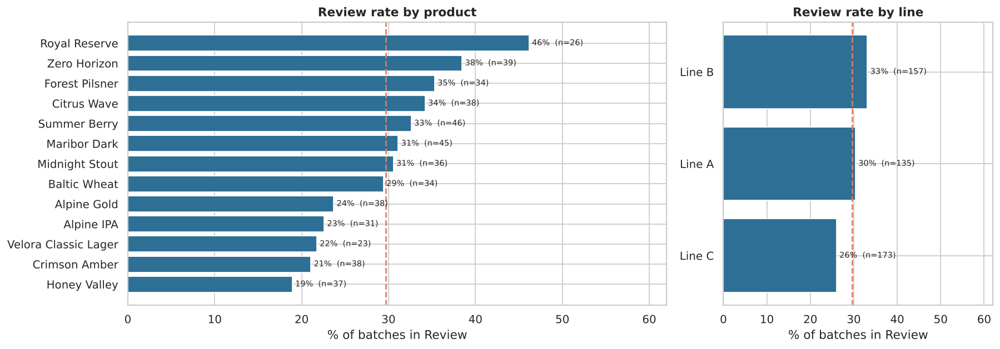
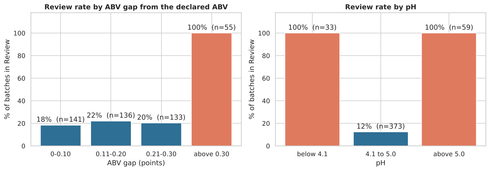
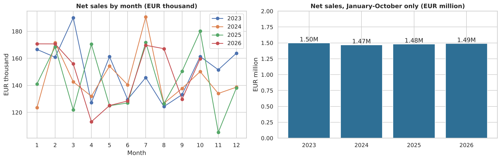
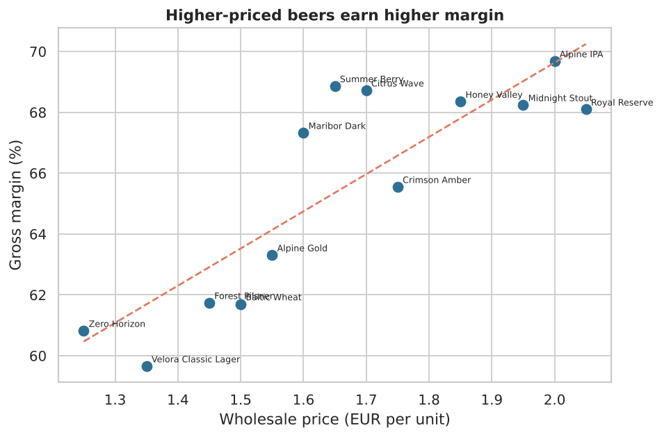
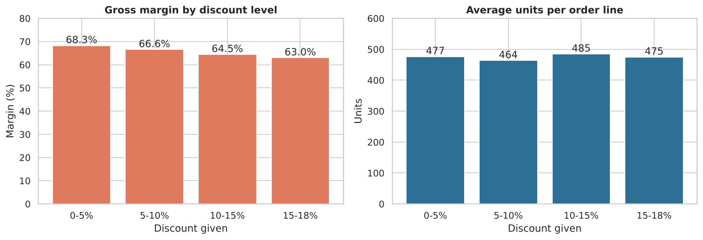
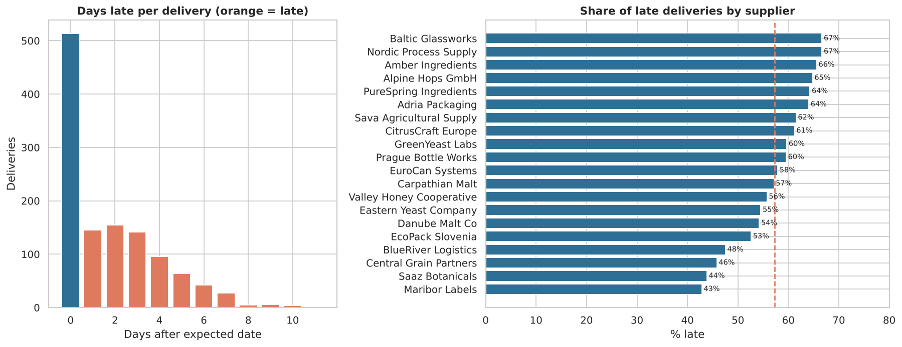
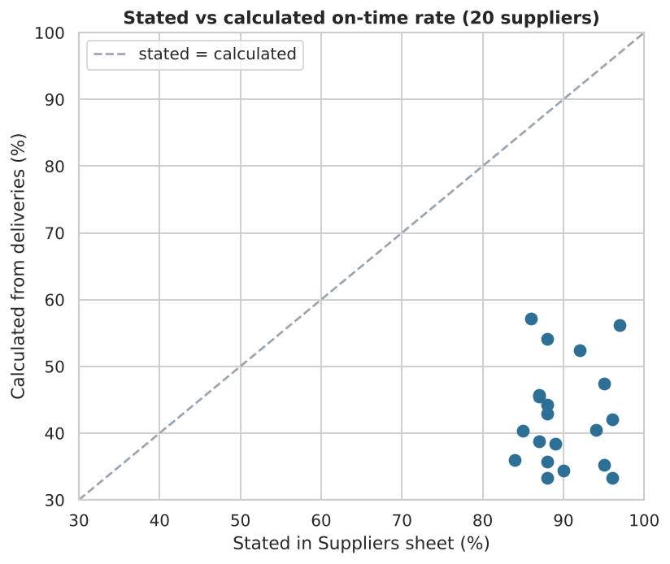

# Velora Brewing: Manufacturing and Sales EDA Report

**Module:** Week 4, Exploratory Data Analysis | **Notebook:** [`notebooks/02_eda.ipynb`](../notebooks/02_eda.ipynb)
**Data:** synthetic brewery records, 2023-01 to 2026-10 (EUR). Findings describe this dataset, not a real brewery.

## 1. Scope and method
- 465 production batches, 465 QC tests, 4,500 orders (11,278 lines), 1,200 purchase orders, plus demand, expense, maintenance and feedback tables.
- Revenue and profit **exclude cancelled orders** (17% of orders).
- 2026 stops at 31 October, so years are compared **Jan-Oct to Jan-Oct**.
- 19 charts are in [`reports/figures/`](figures/); every number below is printed in the notebook.

## 2. Manufacturing

- Average yield is **88.6%** (range 75.1% to 99.0%). **11.3%** of planned volume (105,300 of 929,024 litres) is lost.
- The three lines (88.4% to 89.0%) and the three batch statuses do not differ in yield (ANOVA p = 0.62).
- Every product averages within **1.4 points of its target**; 53% of batches reach their own target.
- Yield is stable by year (88.1% to 89.2%) and unrelated to batch size, cost and shift count.

## 3. Quality control

- **29.7%** of batches go to Review. Rates differ by product (19% to 46%) and line (26% to 33%), but the differences are consistent with chance (chi-square p = 0.49 and 0.36; only 23 to 46 batches per product).
- Raw lab averages look the same for Pass and Review, but that is misleading. **Review is a specification check:** a batch goes to Review when its pH is outside 4.1 to 5.0 or its measured ABV is more than 0.30 points away from the product's declared ABV. This rule matches **99.4%** of batches (the 3 misses sit exactly on the 0.30 boundary). The thresholds were found in the data, so confirm them with the brewery.

## 4. Sales

- Monthly net sales vary between EUR 105k and EUR 191k with **no stable seasonality**.
- **Like for like (Jan-Oct) sales are flat:** EUR 1.50M, 1.47M, 1.48M, 1.49M for 2023 to 2026. The lower 2026 full-year total is only the missing November and December.
- Total net sales EUR 6.77M, gross margin **66.0%**. Top products: Royal Reserve, Midnight Stout, Alpine IPA.

- **Margin rises with price (r = 0.85):** about 60% to 62% for the cheapest beers, 68% to 70% for the most expensive.
- **Discounts cost margin and buy no volume:** margin falls from 68.3% (0-5% discount) to 63.0% (15-18%) while units per line stay at 460 to 485.

- **Online** is 26% of orders but only **2.2%** of sales (online lines average 40 units, never above 80). Margin is 66% in every channel; countries are evenly spread (EUR 0.88M to 1.03M).
- About 17% of orders are cancelled in every quarter and every channel.

## 5. Supply

- **57.2%** of supplier deliveries are late (median 1 day, maximum 11 days). The late share improved from 61.8% in 2023 to about 55% to 57% afterwards.
- The supplier on-time rate stated in the Suppliers sheet (about 90%) has **no relationship** with the rate calculated from deliveries (about 43%, r = 0.05), so only the calculated rate is used.

## 6. Other tables
- Demand_History shows a yearly shape (high Dec to Mar, low Aug to Oct) but reports only 54% to 63% of the units in the order lines and rises while orders are flat.
- Promotion discount has almost no link to units sold (r = 0.05).
- Operating expenses exceed gross profit in all 46 months.
- Preventive maintenance has the longest average downtime (10.2 h), not the shortest.

## 7. Data issues confirmed or found (details in [`docs/data_model.md`](../docs/data_model.md))
1. Stated supplier on-time rate is unusable. 2. Procurement purchases are 4x net sales. 3. Demand_History does not reconcile with orders.
4. `customer_type` and `sales_channel` are unrelated. 5. Online orders are tiny. 6. Expenses exceed gross profit every month.

## 8. What this means (if the data were real)
- **Review discount policy:** deep discounts reduce margin without raising order size.
- **Shift attention to suppliers:** more than half of deliveries are late, regardless of what suppliers claim.
- **Do not chase product or line explanations for yield or QC differences yet:** they are within normal variation. The statistics step (Week 6) tests this properly.

## 9. Next steps
Step 6 (Week 5) builds a reusable cleaning pipeline: rebuild `first_order_date` and `season`, apply the calculated supplier on-time rate, and flag 2026 as a partial year.
